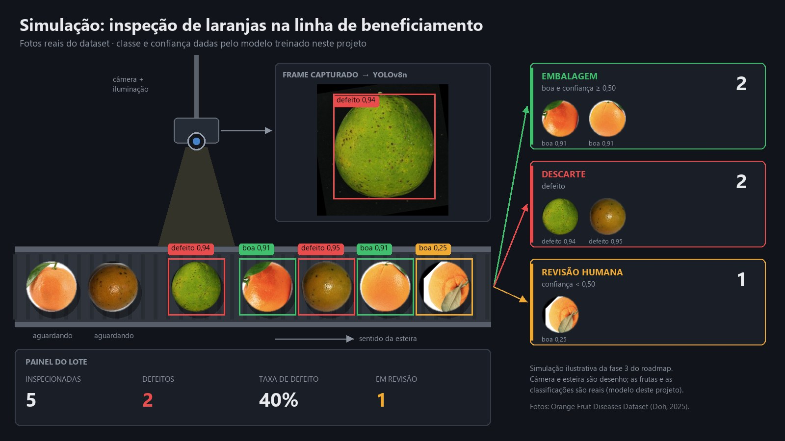
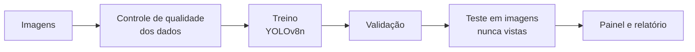
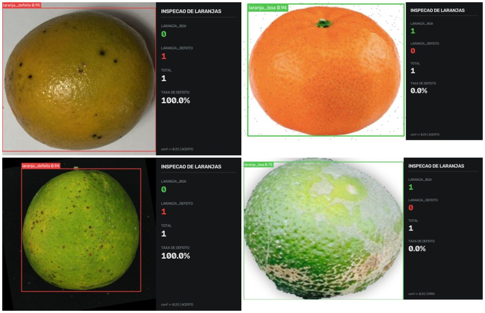
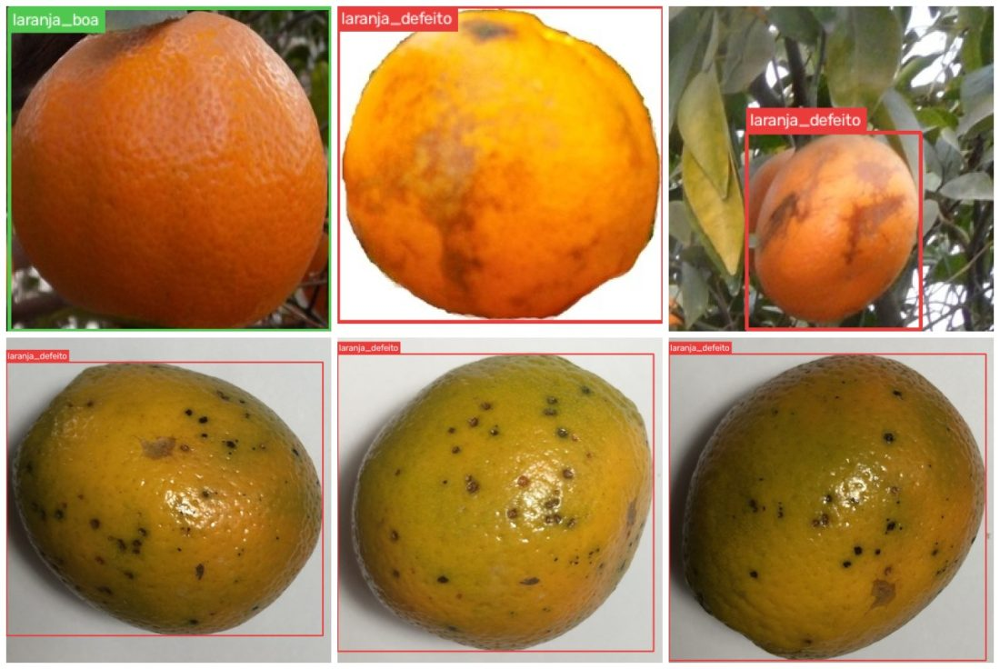
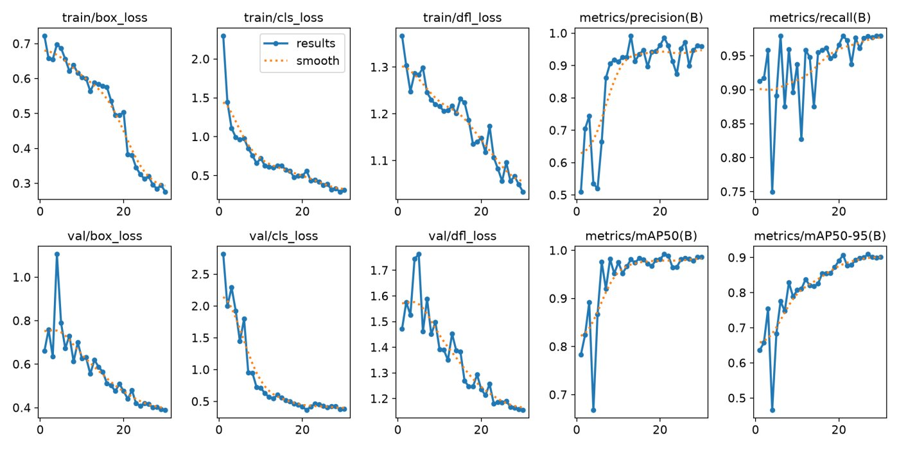

# Citrus YOLO Inspection

Visão computacional para separar laranjas boas das doentes no **beneficiamento de citros**. O sistema
encontra cada fruta na imagem, diz se ela está boa ou com defeito e transforma isso em indicadores do
lote. Desenvolvido por Bruno Henrique da Silveira.



<sub>Simulação da fase 3 do roadmap. A câmera e a esteira são desenho; as frutas são fotos reais e cada
classificação foi feita pelo modelo treinado neste projeto.</sub>

## Por que este projeto existe

Na seleção da laranja, ainda é comum alguém olhar fruta por fruta na esteira. É um trabalho cansativo,
o critério muda de um turno para outro e quase nada fica registrado. Quando uma fruta doente passa
como boa, o problema chega ao cliente.

A proposta é simples: uma câmera olha cada fruta, o modelo decide e o lote ganha números. A fruta boa
segue para a embalagem, a doente vai para o descarte, e o caso duvidoso vai para uma pessoa revisar.

## Como funciona



Cada etapa é um comando e grava o que produziu. A etapa seguinte lê desses arquivos, então nenhum
número do relatório é digitado à mão.

## Regras de negócio

As decisões seguem regras claras, e os parâmetros ficam em
[`backend/configs/projeto.yaml`](backend/configs/projeto.yaml). Hoje o sistema aplica essas regras na
avaliação e no relatório; na linha (fase 3), elas definem o destino de cada fruta, como na simulação.

- **Embalagem:** fruta classificada como boa, com confiança de pelo menos 0,50.
- **Descarte:** fruta classificada com defeito.
- **Revisão humana:** qualquer fruta com confiança abaixo de 0,50 (hoje sinalizada no relatório).
- **Taxa de defeito do lote:** frutas com defeito ÷ total inspecionado.
- **Dados confiáveis:** anotação fora do padrão, imagem duplicada ou "inédita" copiada do treino são barradas antes do treino.
- **Rastreabilidade:** cada comando fica registrado com data e hora.

<details>
<summary><b>Ver as 22 regras completas</b></summary>

| ID | Regra | Efeito |
| --- | --- | --- |
| RN-01 | Toda fruta recebe uma das classes configuradas (mínimo 2) | Classificação |
| RN-02 | A classe de descarte é definida em configuração | Taxa de defeito |
| RN-03 | Detecção só é registrada com confiança ≥ 0,25 | Filtro |
| RN-04 | Confiança < 0,50 vira caso de dúvida | Revisão humana |
| RN-05 | Taxa de defeito = defeitos ÷ total do lote | Painel |
| RN-06 | Acerto exige caixa com IoU ≥ 0,5 **e** classe correta | Avaliação |
| RN-07 | Erro é separado em classe trocada, falso positivo ou não detectada | Avaliação |
| RN-08 | Anotação: 5 valores, classe válida, coordenadas de 0 a 1 | Bloqueia |
| RN-09 | Anotação em polígono não vale como caixa | Bloqueia |
| RN-10 | Imagem sem anotação | Bloqueia |
| RN-11 | Imagens idênticas (mesmo hash) | Descarta |
| RN-12 | Mínimo de 60 imagens anotadas | Bloqueia |
| RN-13 | Mínimo de 5 imagens inéditas | Alerta |
| RN-14 | Classe menor com menos de 50% da maior | Alerta |
| RN-15 | Classe sem nenhuma anotação | Alerta |
| RN-16 | Divisão ~80/20 estratificada, com semente fixa | Automático |
| RN-17 | Cópias da mesma foto ficam do mesmo lado da divisão | Automático |
| RN-18 | Imagem inédita não pode ser cópia do treino | Bloqueia |
| RN-19 | Menos de 20 épocas exige justificativa | Bloqueia |
| RN-20 | Todo comando é registrado com data e hora | Log |
| RN-21 | Indicador sem dado aparece como PENDENTE, nunca estimado | Relatório |
| RN-22 | Dados sintéticos de teste nunca vão para a entrega | Alerta |

</details>

## Resultados

Modelo YOLOv8n treinado por 30 épocas com 240 fotos reais (120 boas e 120 com defeito).

| | Precision | Recall | mAP50 | mAP50-95 |
| --- | ---: | ---: | ---: | ---: |
| **Geral** | 0,899 | 0,978 | 0,986 | 0,904 |
| Laranja boa | 0,839 | 1,000 | 0,990 | 0,904 |
| Laranja com defeito | 0,958 | 0,957 | 0,982 | 0,904 |

O que esses números dizem:

- **Quase nenhuma fruta escapa** (recall de 0,978).
- **O ponto fraco é aprovar fruta doente como boa** (precision de 0,839 na classe boa), que é o erro mais caro na linha.
- **Em 8 fotos que o modelo nunca viu, acertou 5 sem nenhum erro.** Os erros vieram de doenças com poucos exemplos e de uma foto fora do padrão.
- **A validação está otimista.** O dataset tem cópias giradas da mesma foto, então o teste nas fotos inéditas é o retrato mais fiel.



<sub>Resultado real do sistema: três acertos e um erro. A fruta com verrugose (embaixo, à direita) foi aprovada como boa.</sub>

<details>
<summary><b>Mais evidências: dataset, treino, validação e as 8 fotos inéditas</b></summary>

**Dataset anotado**



**Curvas do treino:** as perdas caem e o mAP50 passa de 0,97 já na época 10.



**Matriz de confusão da validação**


**As 8 fotos inéditas, com acerto e erro conferidos contra o gabarito**


</details>

## Próximos passos

| Fase | O que é | Status |
| --- | --- | --- |
| 1. Prova de conceito | Modelo, regras de qualidade e relatório rastreável | ✅ Concluída |
| 2. Piloto de dados | 1.000+ fotos da própria linha, anotadas por tipo de doença | Próxima |
| 3. Piloto na esteira | Câmera em tempo real e painel do lote, como na simulação acima | Planejada |
| 4. Operação | Descarte automático e revisão humana dos casos de dúvida | Planejada |

Antes de ir para a linha, é preciso resolver três coisas: fotografar frutas reais da esteira (o dataset
é de estúdio), equilibrar os tipos de doença e separar treino e validação pela foto de origem.

## Como rodar

Precisa de Python 3.10 ou superior. Tudo roda de dentro de `backend/`.

```powershell
cd backend
python -m venv .venv
.venv\Scripts\Activate.ps1          # Linux/macOS: source .venv/bin/activate
python -m pip install -e ".[dev]"
yolo checks
```

```bash
citrus-yolo preparar     # valida os dados e divide 80/20
citrus-yolo treinar      # treina e salva modelo/best.pt  (--dispositivo 0 para GPU)
citrus-yolo validar      # precision, recall e mAP por classe
citrus-yolo detectar     # painéis nas fotos inéditas
citrus-yolo relatorio    # relatório em PDF
citrus-yolo entregar     # pacote final da atividade
```

Ou tudo de uma vez: `citrus-yolo tudo`. Sem GPU, use o [notebook do Colab](frontend/notebooks/treino_colab.ipynb).
Para os testes, rode `ruff check .` e `pytest` (são 38 testes, que rodam sem GPU).

## Estrutura

```
backend/    pipeline Python: configs, código, scripts e testes
frontend/   relatório em ABNT, notebook do Colab, imagens e documentação
```

Dataset, pesos e resultados completos ficam fora do Git por causa do tamanho e vão no pacote de entrega.

## Créditos

- **Dataset:** Doh, B. (2025). *Orange Fruit Diseases Dataset* (v1). Mendeley Data.
  [doi:10.17632/6szsnpypdd.1](https://doi.org/10.17632/6szsnpypdd.1), licença CC BY 4.0.
  Como o arquivo vem sem caixas, a anotação foi semi-automática e revisada por amostragem
  ([script](backend/scripts/anotar_mendeley.py)).
- **Modelo base:** YOLOv8n, da [Ultralytics](https://github.com/ultralytics/ultralytics).
- **Uso de IA no desenvolvimento:** descrito em [frontend/docs/uso_de_llms.md](frontend/docs/uso_de_llms.md).

Projeto da **Atividade Prática Final de Inteligência Artificial**.
