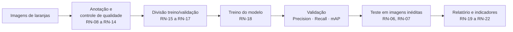
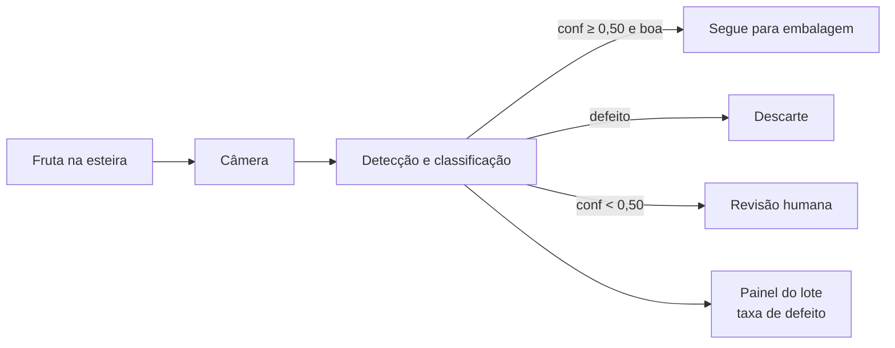

# Citrus YOLO Inspection

**Inspeção visual de laranjas com visão computacional, para apoiar a seleção no beneficiamento de citros.**

O sistema localiza cada laranja numa imagem e a classifica como **boa** ou **com defeito** (doença
visível na casca). Para cada lote de imagens ele gera indicadores de qualidade, como a contagem por
classe e a taxa de defeito.

| | |
| --- | --- |
| **Status** | Prova de conceito validada com dados reais (Atividade Prática Final de IA) |
| **Modelo** | YOLOv8n (Ultralytics), ajustado com 240 imagens reais |
| **Resultado na validação** | mAP50 **0,986** · Recall **0,978** · Precision **0,899** |
| **Resultado em imagens nunca vistas** | **5 de 8** imagens sem nenhum erro |
| **Stack** | Python 3.10+ · Ultralytics · PyTorch · OpenCV · Typer · pytest · GitHub Actions |

---

## 1. Resumo executivo

No beneficiamento, a laranja é lavada, selecionada, classificada e embalada. A **seleção visual** ainda
depende muito de pessoas olhando fruta por fruta na esteira. Esse trabalho é repetitivo, sujeito a
fadiga e varia de um operador para outro. Uma fruta doente que passa como boa compromete o lote, gera
reclamação do cliente e, na exportação, pode causar recusa da carga.

Este projeto prova que um modelo de detecção leve, treinado com poucas centenas de imagens, consegue
**apontar as frutas com defeito e medir a qualidade do lote de forma padronizada e rastreável**. O
resultado ainda não é um produto pronto para a linha. É a base técnica e de processo para um piloto.

## 2. Problema de negócio

| Dor | Impacto |
| --- | --- |
| Inspeção 100% manual | Custo de mão de obra e gargalo de vazão na esteira |
| Critério subjetivo | Lotes classificados de forma diferente por turno ou operador |
| Fadiga ao longo do turno | Mais frutas doentes passando no fim do expediente |
| Falta de registro | Sem histórico de taxa de defeito por lote, produtor ou safra |
| Fruta doente no lote bom | Reclamações, devoluções e risco na exportação |

## 3. Objetivos e proposta de valor

| ID | Objetivo de negócio | Como o sistema atende |
| --- | --- | --- |
| OBJ-01 | Padronizar o critério de seleção | Um único modelo aplica o mesmo critério em todas as imagens |
| OBJ-02 | Reduzir a fruta doente aprovada como boa | Detecção por fruta, com classe e confiança |
| OBJ-03 | Dar visibilidade da qualidade do lote | Painel com contagem por classe e **taxa de defeito** |
| OBJ-04 | Garantir rastreabilidade das decisões | Todo comando, métrica e detecção fica registrado em arquivo |
| OBJ-05 | Tomar decisão com base em evidência | Relatório gerado só com números reais, sem digitação manual |

## 4. Escopo

**Dentro do escopo (implementado)**
- Detecção e classificação de laranjas em imagens: `laranja_boa` × `laranja_defeito`.
- Pipeline completo: dados → treino → validação → teste em imagens inéditas → relatório.
- Painel de inspeção por imagem, com contagem, taxa de defeito e confiança.
- Controles de qualidade de dados e rastreabilidade (seção 5).

**Fora do escopo (próximas fases, seção 10)**
- Integração com câmera e esteira em tempo real.
- Acionamento físico de descarte (ejetor pneumático).
- Classificação por tipo de doença, calibre ou cor de maturação.

## 5. Regras de negócio

Todas as regras abaixo já estão **implementadas e cobertas por testes automatizados**. Os parâmetros
ficam em [`backend/configs/projeto.yaml`](backend/configs/projeto.yaml), o que permite ajustar o
critério sem mexer no código.

### 5.1 Classificação e decisão

| ID | Regra | Parâmetro |
| --- | --- | --- |
| RN-01 | Toda fruta detectada recebe exatamente uma classe da lista configurada (mínimo de 2 classes) | `classes` |
| RN-02 | A classe que representa descarte é definida em configuração e alimenta a taxa de defeito | `deteccao.classe_defeito` |
| RN-03 | Só é registrada a detecção com confiança ≥ 0,25 | `deteccao.confianca` |
| RN-04 | Detecção com confiança < 0,50 é sinalizada como **caso de dúvida**, candidata a revisão humana | relatório |
| RN-05 | Taxa de defeito = frutas com defeito ÷ total de frutas detectadas na imagem | painel |
| RN-06 | Na conferência com gabarito, só conta como acerto a caixa que cobre ≥ 50% da fruta real (IoU ≥ 0,5) **e** tem a classe correta | detecção |
| RN-07 | Todo erro é classificado em um de três tipos: classe trocada, falso positivo ou fruta não detectada | detecção |

### 5.2 Qualidade dos dados

| ID | Regra | Comportamento |
| --- | --- | --- |
| RN-08 | Cada anotação precisa ter 5 valores, classe válida e coordenadas normalizadas entre 0 e 1 | **Bloqueia** e aponta arquivo e linha |
| RN-09 | Anotação em polígono (segmentação) não é aceita como caixa | **Bloqueia** com orientação de exportação |
| RN-10 | Imagem sem anotação correspondente impede o preparo | **Bloqueia** |
| RN-11 | Imagens idênticas (mesmo hash) são descartadas, mantendo só a primeira | Descarta e avisa |
| RN-12 | Mínimo de 60 imagens anotadas | **Bloqueia** (exceção explícita com `--forcar`) |
| RN-12a | Mínimo de 5 imagens inéditas para o teste final | Alerta no preparo e pendência na entrega |
| RN-13 | Se a classe menor tiver menos de 50% das caixas da maior, o dataset é sinalizado como desbalanceado | Alerta |
| RN-14 | Uma classe sem nenhuma anotação é sinalizada | Alerta |

### 5.3 Confiabilidade da avaliação

| ID | Regra | Comportamento |
| --- | --- | --- |
| RN-15 | Divisão de ~80% para treino e ~20% para validação, estratificada por classe e com semente fixa (reprodutível) | Automático |
| RN-16 | Cópias aumentadas da mesma foto de origem (padrão de nome do Roboflow) ficam todas do mesmo lado da divisão | Automático |
| RN-17 | Uma imagem "inédita" não pode ser cópia de nenhuma imagem de treino ou validação | **Bloqueia** |
| RN-18 | Treino com menos de 20 épocas exige justificativa registrada | **Bloqueia** sem justificativa |

### 5.4 Governança e rastreabilidade

| ID | Regra | Comportamento |
| --- | --- | --- |
| RN-19 | Todo comando executado é registrado com data, hora e o comando equivalente do Ultralytics | Log automático |
| RN-20 | Nenhum indicador do relatório é digitado à mão: tudo vem dos arquivos de resultado | Seção marcada como **PENDENTE** se faltar dado |
| RN-21 | Dados sintéticos (de teste) nunca podem ir para a entrega | Alerta em vermelho no relatório e na entrega |
| RN-22 | A entrega só fica completa sem pendências (modelo, métricas, 5+ detecções, relatório, prints) | Lista de pendências |

## 6. Processo

**Hoje (prova de conceito):** as imagens passam pelo pipeline em lote.



**Visão de futuro (piloto na linha):**



## 7. Indicadores: como ler para tomar decisão

| Métrica técnica | Pergunta de negócio | Erro que ela evita |
| --- | --- | --- |
| **Recall** da classe defeito | Das frutas doentes, quantas o sistema barra? | Fruta doente seguindo para o cliente |
| **Precision** da classe boa | Quando o sistema aprova, a fruta é mesmo boa? | Fruta doente aprovada (o erro mais caro) |
| **Precision** da classe defeito | Quando o sistema descarta, a fruta é mesmo doente? | Descarte de fruta boa (perda de receita) |
| **mAP50** | Qual a qualidade geral da detecção? | Visão consolidada do modelo |
| **mAP50-95** | As caixas estão bem posicionadas? | Base para contagem e medição de calibre |
| **Taxa de defeito** | Qual a qualidade deste lote? | Decisão de aceite, preço ou destino do lote |

## 8. Resultados

**Dados:** [Orange Fruit Diseases Dataset](https://doi.org/10.17632/6szsnpypdd.1) (Doh, 2025,
Mendeley Data, CC BY 4.0). Foram 240 imagens equilibradas (120 boas e 120 com defeito: mancha preta,
cancro, greening e verrugose), divididas em 192 para treino e 48 para validação, mais 8 inéditas.

**Treino:** YOLOv8n, 30 épocas, imagem 640 px, em CPU, levou 27 minutos.

| Classe | Precision | Recall | mAP50 | mAP50-95 |
| --- | ---: | ---: | ---: | ---: |
| **Geral** | 0,899 | 0,978 | 0,986 | 0,904 |
| laranja_boa | 0,839 | 1,000 | 0,990 | 0,904 |
| laranja_defeito | 0,958 | 0,957 | 0,982 | 0,904 |

**Leitura de negócio**
- O sistema **encontra quase todas as frutas** (recall de 0,978) e acerta bem a posição delas.
- O ponto de atenção é a **precision da classe boa (0,839)**: parte das caixas marcadas como "boa"
  estava errada (fruta com defeito ou caixa sobrando). Na linha, aprovar fruta doente é o erro mais caro.
- Nas **8 imagens inéditas**, 5 saíram sem erro. Os 3 erros foram: dúvida entre boa e defeito numa
  fruta com cancro, uma fruta com verrugose aprovada como boa (doença com só 4 exemplos no dataset)
  e uma fruta não detectada numa foto atípica.
- **A validação está otimista.** O dataset público tem cópias giradas da mesma foto, que a remoção de
  duplicatas não pega. O resultado nas inéditas é o retrato mais fiel do desempenho real.

## 9. Riscos e limitações

| Risco | Impacto | Mitigação proposta |
| --- | --- | --- |
| Dataset público com fotos de estúdio, diferente da esteira real | Desempenho menor na linha | Coletar imagens na própria unidade de beneficiamento |
| Anotação semi-automática (caixas propostas por modelo e revisadas por amostragem) | Pequenos erros de caixa | Revisão manual completa no piloto |
| Doenças sub-representadas (verrugose) | Fruta doente aprovada como boa | Balancear o dataset por tipo de doença |
| Fundo diferente entre as classes nas fotos | Modelo aprender o fundo, e não a fruta | Padronizar a captura e variar fundos no treino |
| Validação com cópias giradas da mesma foto | Métrica superestimada | Separar treino e validação por foto de origem |

## 10. Recomendações e roadmap

| Fase | Entrega | Critério para avançar |
| --- | --- | --- |
| **1. Prova de conceito** ✅ | Modelo treinado, regras de qualidade, relatório rastreável | Pipeline funcionando ponta a ponta |
| **2. Piloto de dados** | 1.000+ imagens da própria linha, anotadas manualmente e por tipo de doença | Recall de defeito e precision de boa medidos em imagens inéditas da linha |
| **3. Piloto na esteira** | Câmera, detecção em vídeo com rastreamento da fruta e painel por lote | Comparação com a inspeção manual no mesmo lote |
| **4. Operação** | Descarte automático, revisão humana dos casos de dúvida (RN-04) e histórico por produtor | Indicadores estáveis por safra |

## 11. Arquitetura

O repositório separa o **backend** (o pipeline de dados, treino e avaliação) do **frontend** (a camada
de apresentação: o que as pessoas leem e usam).

```
citrus-yolo-inspection/
├── README.md
├── backend/                       # pipeline Python (os comandos rodam daqui)
│   ├── configs/
│   │   ├── projeto.yaml           # classes, regras, caminhos e hiperparâmetros
│   │   └── relatorio.yaml         # textos do relatório
│   ├── src/citrus_yolo/           # config, dataset, treino, detecção, relatório, entrega, CLI
│   ├── scripts/                   # anotação semi-automática do dataset público
│   ├── tests/                     # 38 testes automatizados (rodam sem GPU)
│   ├── dataset/ · modelo/ · resultados/
│   └── pyproject.toml · comandos.txt · AGENTS.md · CLAUDE.md
├── frontend/
│   ├── apresentacao/              # apresentação executiva (.docx) e o script que a gera
│   ├── notebooks/                 # execução no Google Colab (GPU gratuita)
│   └── docs/                      # registro de uso de IA no desenvolvimento
├── .github/workflows/ci.yml       # lint + testes a cada push
└── .vscode/                       # tasks de cada etapa
```

## 12. Como executar

Requer Python 3.10+. Todos os comandos rodam de dentro de `backend/`.

```powershell
cd backend
python -m venv .venv
.venv\Scripts\Activate.ps1          # Linux/macOS: source .venv/bin/activate
pip install -e ".[dev]"
yolo checks
```

| Etapa | Comando | O que produz |
| --- | --- | --- |
| Dados | `python scripts/anotar_mendeley.py "<pasta>/Orange Fruit Diseases"` | Dataset anotado em `dataset/bruto/` |
| Preparo | `citrus-yolo preparar` | Divisão 80/20, `data.yaml` e checklist de qualidade |
| Treino | `citrus-yolo treinar` (`--dispositivo 0` para GPU) | `modelo/best.pt`, curvas e tabela por época |
| Validação | `citrus-yolo validar` | Métricas gerais e por classe |
| Teste | `citrus-yolo detectar` | Painéis de inspeção, CSV e acerto/erro nas inéditas |
| Relatório | `citrus-yolo relatorio` | `resultados/relatorio/relatorio.pdf` |
| Entrega | `citrus-yolo entregar` | ZIP final e lista de pendências |

Também é possível rodar tudo de uma vez com `citrus-yolo tudo`, ou usar o
[notebook do Colab](frontend/notebooks/treino_colab.ipynb) se o computador não tiver GPU. Os comandos
equivalentes do Ultralytics estão em [`backend/comandos.txt`](backend/comandos.txt).

> **Observação técnica.** Nos comandos `yolo` diretos, use `project=` com caminho **absoluto**. Se
> for relativo ou omitido, o Ultralytics 8.4 grava no `runs_dir` global, fora do projeto.

## 13. Qualidade de engenharia

- **38 testes automatizados** cobrindo regras de negócio, qualidade de dados, divisão sem vazamento,
  painel, relatório e entrega.
- **CI no GitHub Actions** (lint com Ruff e testes no Python 3.10 e 3.12).
- **Configuração validada** antes de qualquer execução: um erro de digitação no YAML é barrado com
  mensagem clara.
- **Reprodutibilidade:** a semente é fixa e o log registra todos os comandos executados.

```bash
cd backend
ruff check .
pytest
```

## 14. Contexto acadêmico

Este projeto atende à **Atividade Prática Final de Inteligência Artificial**: treinar um modelo YOLO
com dataset próprio, com no mínimo 2 classes, 60 imagens, 20 épocas e 5 imagens inéditas.

| Critério (pontos) | Evidência (em `backend/`) |
| --- | --- |
| Dataset, classes e anotações (2,0) | `resultados/dataset/`, `dataset/bruto/ORIGEM.json` |
| Configuração e treino (2,0) | `resultados/treino/`, `modelo/best.pt`, `resultados/prints/` |
| Validação e métricas (2,0) | `resultados/validacao/metricas.md` |
| Imagens inéditas (2,0) | `resultados/deteccoes/` |
| Relatório e análise crítica (2,0) | `resultados/relatorio/relatorio.pdf` |

**Pendências antes do envio:** print da tela do treino em `resultados/prints/`, revisão dos textos
em `configs/relatorio.yaml` e preenchimento de curso, instituição e professor em `configs/projeto.yaml`.

## 15. Créditos

- **Dataset:** Doh, B. (2025). *Orange Fruit Diseases Dataset* (v1). Mendeley Data.
  [doi:10.17632/6szsnpypdd.1](https://doi.org/10.17632/6szsnpypdd.1), licença CC BY 4.0.
- **Modelo base:** YOLOv8n, da [Ultralytics](https://github.com/ultralytics/ultralytics).
- **Uso de IA no desenvolvimento:** registrado em [frontend/docs/uso_de_llms.md](frontend/docs/uso_de_llms.md).
  As regras para agentes ficam em [backend/AGENTS.md](backend/AGENTS.md).

**Autor:** Bruno Silveira
