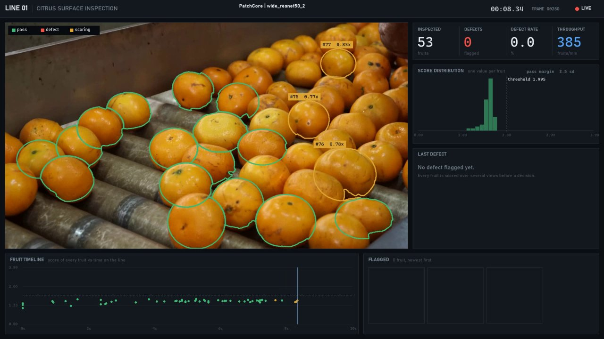
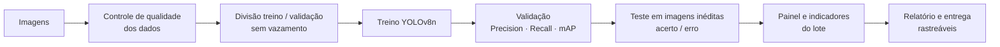
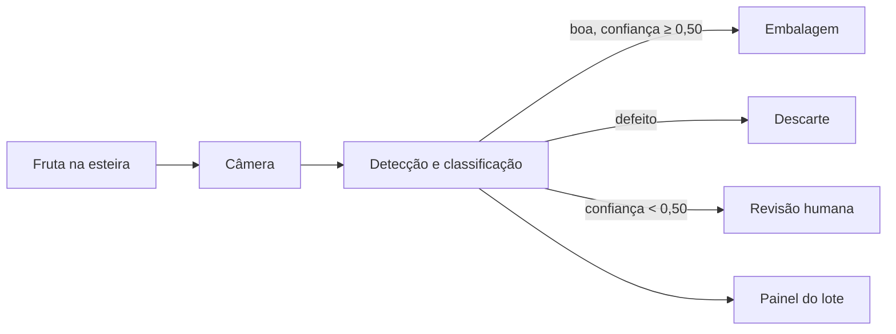
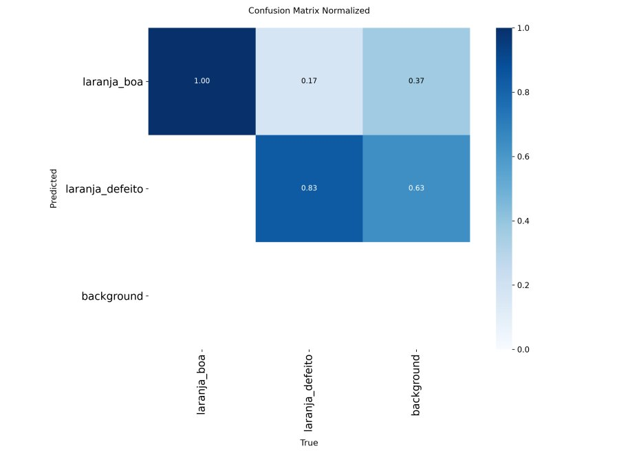
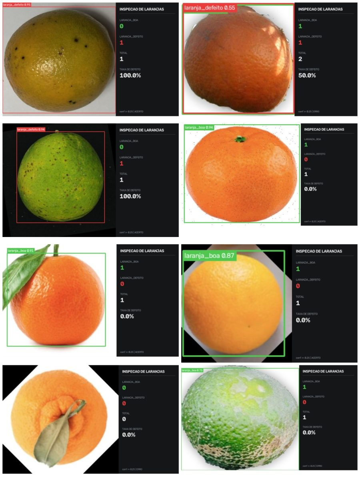

# Citrus YOLO Inspection

Inspeção visual de laranjas com visão computacional para apoiar a **seleção no beneficiamento de
citros**: o sistema detecta cada fruta, separa as boas das que têm doença na casca e transforma o
resultado em indicadores de qualidade por lote. Desenvolvido por Bruno Henrique da Silveira.



<sub>**Referência visual da visão de futuro (fase 3 do roadmap). Esta imagem não foi gerada por este
projeto.** É o dashboard de inspeção em esteira do
[citrus-inspection-vision](https://github.com/francisco-cst-oliveira/citrus-inspection-vision), de
Francisco Oliveira (modelo PatchCore, vídeo de Thiago Zanutim Lucas via Pexels). Ela mostra aonde
esta solução pode chegar na linha de beneficiamento.</sub>

**Resultado deste projeto:** painéis de inspeção gerados pelo sistema em imagens que o modelo nunca viu.


<sub>Três acertos e um erro real: a fruta com verrugose (embaixo, à direita) foi aprovada como boa.
É esse tipo de caso que a análise de negócio abaixo trata.</sub>

## O que está neste repositório

- detecção e classificação de laranjas (`laranja_boa` × `laranja_defeito`) com YOLOv8;
- pipeline completo: preparo dos dados → treino → validação → teste em imagens inéditas → relatório;
- painel de inspeção por imagem, com contagem por classe, taxa de defeito e confiança;
- 22 regras de negócio para qualidade de dados, decisão e rastreabilidade;
- conferência automática de acerto e erro, separando classe trocada, falso positivo e fruta não detectada;
- relatório gerado só com números reais, sem digitação manual;
- 38 testes automatizados e CI no GitHub Actions.

## Contexto de negócio

No beneficiamento, a laranja é lavada, selecionada, classificada e embalada. A **seleção visual**
ainda depende de pessoas olhando fruta por fruta na esteira.

| Dor da operação | Impacto | Resposta do sistema |
| --- | --- | --- |
| Inspeção 100% manual | Custo de mão de obra e gargalo de vazão | Detecção automática de cada fruta |
| Critério subjetivo | Classificação diferente por turno ou operador | Mesmo critério aplicado a todas as imagens |
| Fadiga ao longo do turno | Mais fruta doente passando no fim do expediente | Desempenho constante, sem cansaço |
| Falta de registro | Sem histórico de qualidade por lote ou produtor | Taxa de defeito e log de cada execução |
| Fruta doente no lote bom | Reclamação, devolução e risco na exportação | Classe e confiança por fruta, com casos de dúvida sinalizados |

**Objetivo da prova de conceito:** mostrar que um modelo leve, treinado com poucas centenas de
imagens, consegue apontar a fruta com defeito de forma padronizada e rastreável, criando a base
técnica e de processo para um piloto na linha.

## Arquitetura



O sistema separa o **backend** (pipeline Python: dados, treino, avaliação e regras) do **frontend**
(o que as pessoas leem e usam: apresentação, notebook e documentação). Cada etapa grava o que
produziu, e a seguinte lê desses arquivos, então nenhum indicador é digitado à mão.

Visão de futuro para a linha de beneficiamento:



## Regras de negócio

Todas as regras estão implementadas e cobertas por testes. Os parâmetros ficam em
[`backend/configs/projeto.yaml`](backend/configs/projeto.yaml), então dá para ajustar o critério sem
mexer no código.

**Classificação e decisão**

| ID | Regra | Parâmetro |
| --- | --- | --- |
| RN-01 | Toda fruta detectada recebe uma classe da lista configurada (mínimo de 2 classes) | `classes` |
| RN-02 | A classe de descarte é definida em configuração e alimenta a taxa de defeito | `deteccao.classe_defeito` |
| RN-03 | Só é registrada a detecção com confiança ≥ 0,25 | `deteccao.confianca` |
| RN-04 | Confiança < 0,50 é sinalizada como caso de dúvida, candidato a revisão humana | relatório |
| RN-05 | Taxa de defeito = frutas com defeito ÷ total de frutas detectadas | painel |
| RN-06 | Acerto só quando a caixa cobre ≥ 50% da fruta real (IoU ≥ 0,5) **e** a classe está correta | detecção |
| RN-07 | Todo erro é classificado: classe trocada, falso positivo ou fruta não detectada | detecção |

**Qualidade dos dados**

| ID | Regra | Comportamento |
| --- | --- | --- |
| RN-08 | Anotação com 5 valores, classe válida e coordenadas normalizadas entre 0 e 1 | Bloqueia e aponta arquivo e linha |
| RN-09 | Anotação em polígono não é aceita como caixa | Bloqueia |
| RN-10 | Imagem sem anotação impede o preparo | Bloqueia |
| RN-11 | Imagens idênticas (mesmo hash) são descartadas | Descarta e avisa |
| RN-12 | Mínimo de 60 imagens anotadas | Bloqueia (exceção explícita com `--forcar`) |
| RN-13 | Mínimo de 5 imagens inéditas para o teste final | Alerta e pendência na entrega |
| RN-14 | Classe menor com menos de 50% das caixas da maior: dataset desbalanceado | Alerta |
| RN-15 | Classe sem nenhuma anotação | Alerta |

**Confiabilidade da avaliação e governança**

| ID | Regra | Comportamento |
| --- | --- | --- |
| RN-16 | Divisão ~80/20 estratificada por classe, com semente fixa (reprodutível) | Automático |
| RN-17 | Cópias aumentadas da mesma foto de origem ficam do mesmo lado da divisão | Automático |
| RN-18 | Imagem "inédita" não pode ser cópia de imagem de treino ou validação | Bloqueia |
| RN-19 | Treino com menos de 20 épocas exige justificativa | Bloqueia sem justificativa |
| RN-20 | Todo comando é registrado com data, hora e o equivalente do Ultralytics | Log automático |
| RN-21 | Indicador sem dado de origem aparece como **PENDENTE**, nunca estimado | Relatório |
| RN-22 | Dados sintéticos de teste nunca vão para a entrega | Alerta em vermelho |

## Indicadores

Resultados do modelo treinado (YOLOv8n, 30 épocas, 192 imagens de treino e 48 de validação):

| Classe | Precision | Recall | mAP50 | mAP50-95 |
| --- | ---: | ---: | ---: | ---: |
| **Geral** | 0,899 | 0,978 | 0,986 | 0,904 |
| laranja_boa | 0,839 | 1,000 | 0,990 | 0,904 |
| laranja_defeito | 0,958 | 0,957 | 0,982 | 0,904 |

Em **8 imagens inéditas**, 5 saíram sem nenhum erro.

| Métrica | Pergunta de negócio | Leitura deste resultado |
| --- | --- | --- |
| Recall | Das frutas presentes, quantas o sistema encontra? | 0,978: quase nenhuma fruta escapa |
| Precision da classe boa | Quando o sistema aprova, a fruta é mesmo boa? | 0,839: é o ponto de atenção, porque aprovar fruta doente é o erro mais caro |
| Precision da classe defeito | Quando o sistema descarta, a fruta é mesmo doente? | 0,958: pouco descarte de fruta boa |
| mAP50-95 | As caixas estão bem posicionadas? | 0,904: base sólida para contagem |

**A validação está otimista.** O dataset público tem cópias giradas da mesma foto, que a remoção de
duplicatas não detecta. O resultado nas imagens inéditas (5 de 8) é o retrato mais fiel do
desempenho real. Os números representam uma prova de conceito controlada e não substituem a
validação na linha de produção.

## Evidências

**Dataset anotado.** Exemplos de imagens de treino com as caixas de cada classe.


**Treinamento.** As perdas caem de forma contínua, e o mAP50 passa de 0,97 já na época 10.


**Validação.** Matriz de confusão normalizada: mostra onde estão as trocas entre as classes.



**Imagens inéditas.** Os 8 painéis com acerto ou erro conferidos contra o gabarito. Os 3 erros
foram: dúvida entre boa e defeito numa fruta com cancro, uma fruta com verrugose aprovada como boa
(doença com só 4 exemplos no dataset) e uma laranja não detectada numa foto girada, com folha por cima.



## Riscos e próximos passos

| Risco | Mitigação |
| --- | --- |
| Fotos de estúdio, diferentes da esteira real | Coletar imagens na própria unidade de beneficiamento |
| Anotação semi-automática | Revisão manual completa das caixas |
| Doenças pouco representadas (verrugose) | Balancear o dataset por tipo de doença |
| Fundo diferente entre as classes | Padronizar a captura e variar os fundos no treino |
| Cópias giradas entre treino e validação | Separar a divisão pela foto de origem |

| Fase | Entrega | Critério para avançar |
| --- | --- | --- |
| 1. Prova de conceito ✅ | Modelo, regras de qualidade e relatório rastreável | Pipeline funcionando de ponta a ponta |
| 2. Piloto de dados | 1.000+ imagens da própria linha, anotadas por tipo de doença | Recall de defeito e precision de boa medidos em imagens inéditas da linha |
| 3. Piloto na esteira | Câmera, detecção em vídeo com rastreamento e painel por lote | Comparação com a inspeção manual no mesmo lote |
| 4. Operação | Descarte automático e revisão humana dos casos de dúvida | Indicadores estáveis por safra |

## Execução local

Requer Python 3.10 ou superior. Os comandos rodam de dentro de `backend/`.

```powershell
cd backend
python -m venv .venv
.venv\Scripts\Activate.ps1            # Linux/macOS: source .venv/bin/activate
python -m pip install -e ".[dev]"
yolo checks
```

| Etapa | Comando | Resultado |
| --- | --- | --- |
| Dados | `python scripts/anotar_mendeley.py "<pasta>/Orange Fruit Diseases"` | Dataset anotado em `dataset/bruto/` |
| Preparo | `citrus-yolo preparar` | Divisão 80/20, `data.yaml` e checklist de qualidade |
| Treino | `citrus-yolo treinar` (`--dispositivo 0` para GPU) | `modelo/best.pt`, curvas e tabela por época |
| Validação | `citrus-yolo validar` | Métricas gerais e por classe |
| Teste | `citrus-yolo detectar` | Painéis, CSV e acerto/erro nas inéditas |
| Relatório | `citrus-yolo relatorio` | `resultados/relatorio/relatorio.pdf` |
| Entrega | `citrus-yolo entregar` | ZIP final e lista de pendências |

Para rodar tudo de uma vez, use `citrus-yolo tudo`. Sem GPU, há o
[notebook do Colab](frontend/notebooks/treino_colab.ipynb). Os comandos equivalentes do Ultralytics
estão em [`backend/comandos.txt`](backend/comandos.txt). Nos comandos `yolo` diretos, use `project=`
com caminho absoluto; caso contrário, o Ultralytics grava fora do projeto.

Testes:

```bash
cd backend
python -m pip install -e ".[dev]"
ruff check .
pytest
```

## Estrutura

```
citrus-yolo-inspection/
├── README.md
├── backend/                  # pipeline Python
│   ├── configs/              # projeto.yaml (regras e parâmetros) e relatorio.yaml
│   ├── src/citrus_yolo/      # config, dataset, treino, detecção, relatório, entrega e CLI
│   ├── scripts/              # anotação semi-automática do dataset público
│   └── tests/                # 38 testes (rodam sem GPU)
├── frontend/
│   ├── apresentacao/         # relatório técnico em ABNT (.docx)
│   ├── notebooks/            # execução no Google Colab
│   └── docs/                 # imagens de evidência e registro do uso de IA
└── .github/workflows/ci.yml  # lint e testes a cada push
```

Dataset, pesos treinados e resultados completos não são versionados por causa do tamanho. Eles vão
no pacote de entrega da atividade.

## Dataset e créditos

- **Dataset:** Doh, B. (2025). *Orange Fruit Diseases Dataset* (v1). Mendeley Data.
  [doi:10.17632/6szsnpypdd.1](https://doi.org/10.17632/6szsnpypdd.1), licença CC BY 4.0. Tem 700 fotos
  por diagnóstico (saudável, mancha preta, cancro, greening e verrugose). Como o arquivo não traz
  caixas, a anotação foi semi-automática e revisada por amostragem
  ([`backend/scripts/anotar_mendeley.py`](backend/scripts/anotar_mendeley.py)). Ficaram 240 imagens
  equilibradas e mais 8 inéditas.
- **Modelo base:** YOLOv8n, da [Ultralytics](https://github.com/ultralytics/ultralytics), pré-treinado no COCO.
- **Uso de IA no desenvolvimento:** registrado em [frontend/docs/uso_de_llms.md](frontend/docs/uso_de_llms.md).

Projeto desenvolvido como **Atividade Prática Final da disciplina de Inteligência Artificial**:
treinamento de um modelo YOLO com dataset próprio, com no mínimo 2 classes, 60 imagens anotadas,
20 épocas e 5 imagens inéditas.
